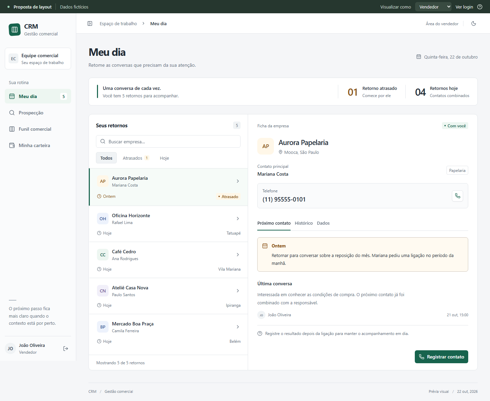
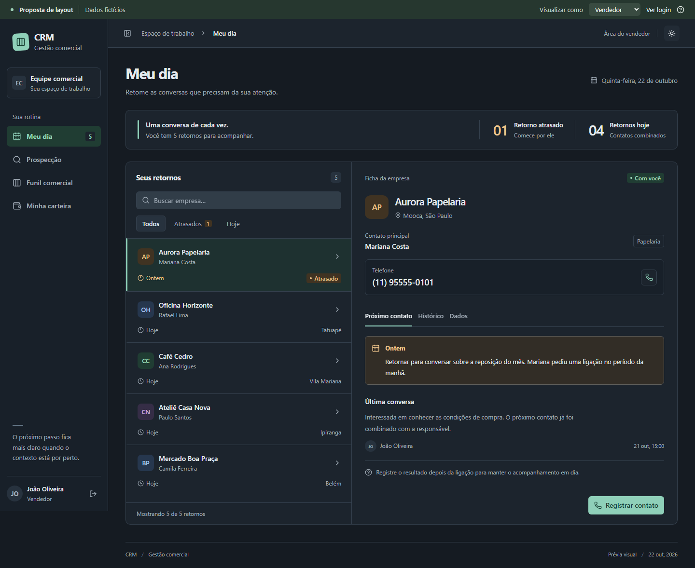

# Referência visual aprovada em 22/10/2026

Capturas do protótipo navegável aprovado pelo usuário. Todos os dados são
fictícios. As imagens não demonstram a implementação no CRM real nem autorizam
novos campos, consultas ou regras de negócio.

Especificação: [Redesenho completo do CRM](../../superpowers/specs/2026-10-22-redesign-crm-design.md).
Plano: [Etapas de implementação](../../superpowers/plans/2026-10-22-redesign-crm.md).

Aplicação real: [validação, cobertura e capturas](validacao.md).
Dependência em outra branch: [integração CNPJ.biz](integracao-cnpj-biz.md).

## Meu dia

Celular: [lista](meu-dia-celular.png) e [ficha](ficha-celular.png).

## Demais composições

- [Gestão](gestao.png)
- [Funil](funil.png)
- [WhatsApp](whatsapp.png)
- [Login](login.png)

O protótipo também apresentou Carteira, Prospecção, Empresas, Grupos e Usuários.
Essas áreas seguem as composições e os contratos descritos na especificação;
a implementação real terá suas próprias capturas.

## Fontes

[Manifesto dos componentes obtidos](fontes-componentes.json), com URLs públicas
de shadcn/ui e SmoothUI. As abas foram encontradas no catálogo 21st e obtidas
diretamente do registro público do autor após falhas de busca do MCP.

Não foi versionada a URL temporária da prévia nem sua chave de acesso.
